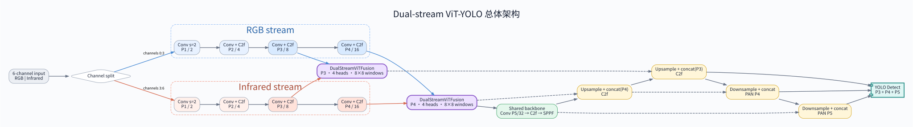
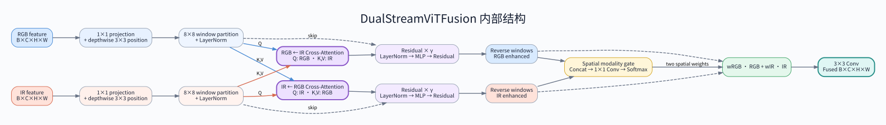

# 双流 ViT-YOLO 网络架构

当前实现是混合式 CNN–Transformer 检测网络：YOLOv8 的卷积主干负责多尺度局部特征提取，
`DualStreamViTFusion` 在 P3 和 P4 层将特征图视为 token，执行窗口化双向跨模态注意力。
它不是将整个 YOLO 主干替换为原版 ViT，但融合块包含完整的多头注意力、LayerNorm、残差和 MLP。

## 整体网络

## 融合块内部

融合块的核心计算为：

1. 对 RGB、红外特征分别加入卷积位置编码并划分为 `8×8` 局部窗口。
2. 使用 RGB token 作为 Query、红外 token 作为 Key/Value，计算 RGB 增强特征。
3. 反向使用红外 Query、RGB Key/Value，计算红外增强特征。
4. 两个方向均经过残差连接、LayerNorm 和 Transformer MLP。
5. 空间模态门控为每个位置预测 RGB/红外权重，得到融合特征。

窗口注意力可将单层复杂度从全局注意力的近似 `O((HW)^2)` 降低为
`O(HW × window_size²)`，适合 YOLO 的 P3/P4 特征层。
